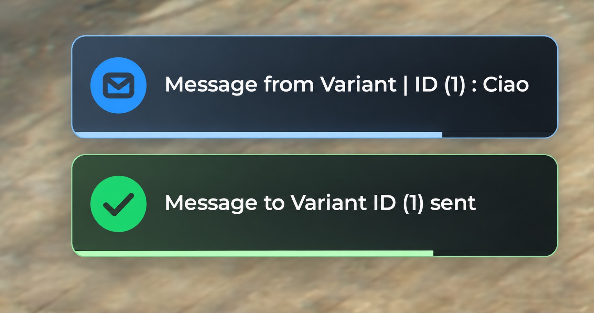

# Variaantt's Private Messages

A lightweight private messaging system for FiveM. Players send private messages to each other by server ID with `/pm`, and the receiver can answer the last person who wrote to them with `/r`. Messages appear as modern on-screen notifications with an icon, a sound and a progress bar, and they support bold and italic text.



## Features

- `/pm <id> <message>` sends a private message to the player with that server ID
- `/r <message>` answers the last player who sent you a message or an answer, so the conversation can continue in both directions
- Notification UI (NUI) in the top-right corner, with a different icon and bar color for each type: sent confirmation, received message, answer and error
- Display time that grows with the length of the message, so long messages stay on screen longer (minimum and maximum are configurable)
- Text formatting: `**bold**` and `__italic__`
- Received messages and answers are also printed to the client console (F8), so if you miss a notification you can read it again
- Sound played when a message or an answer arrives
- Input checks on the server: valid ID, connected player, non-empty message
- Text is never inserted as HTML (formatting is built with DOM elements and `textContent`), so players cannot inject HTML into other players' screens

## Requirements

- A FiveM server and a recent FiveM client (the notifications use modern CSS)
- Lua 5.4 (enabled in the manifest with `lua54 'yes'`)

No other resources or frameworks are required.

## Installation

1. Download the latest version from the [Releases](../../releases) page, or clone this repository.
2. Put the folder inside your server's `resources` directory and make sure it is named `variaantt-pm`. GitHub zips usually add the version number to the folder name, so rename it if needed.
3. Add the resource to your `server.cfg`:

   ```cfg
   ensure variaantt-pm
   ```

   Use the same name as the folder.
4. Restart the server, or run `refresh` and `ensure variaantt-pm` from the console.

## Usage

| Command | Who can use it | Description |
|---|---|---|
| `/pm <id> <message>` | Everyone (see the warning below) | Sends a private message to the player with the given server ID |
| `/r <message>` | Everyone | Answers the last player who sent you a message or an answer |

Examples:

```
/pm 12 Hello, can you come to the garage?
/r Sure, I'm on my way
```

You can see a player's ID in the scoreboard or in the server player list.

## Text formatting

| You write | You get |
|---|---|
| `**text**` | **text** (bold) |
| `__text__` | *text* (italic) |

Example:

```
/pm 12 Meet me **now** at the __garage__
```

Rules:

- Both markers must be closed, otherwise the text is shown exactly as typed.
- Bold and italic cannot be nested inside each other.
- Anything else, including HTML tags, is shown as plain text.

## Important: there is no permission check

By default **anyone** can use `/pm`. This resource does not include an admin check on purpose, so it can be adapted to any server setup.

If you want only admins to send messages, add a check at the very beginning of the `/pm` command in `server.lua`. For example, with ACE permissions you can use `IsPlayerAceAllowed(source, "your.permission")` and return early if it is false, then grant the permission in `server.cfg` with `add_ace` and `add_principal`. If you use a framework (ESX, QBCore, ...), use its own permission or group system instead.

## How it works

```
/pm (server.lua)  ->  TriggerClientEvent  ->  client.lua  ->  SendNUIMessage  ->  script.js (notification)
```

1. The server registers the commands, validates the input and keeps a table with the last person each player can answer with `/r`. The table is updated every time a message or an answer is sent.
2. The server sends the `sendMessage` event to the right client with a type and a text.
3. The client receives the event, prints received messages and answers to its console (F8) and forwards the message to the NUI page.
4. The page builds the notification, formats the text, plays the sound for received messages and answers and removes the notification when its time is over. The display time depends on the length of the message.

Notification types sent by the server:

| Type | Used for |
|---|---|
| `msg` | A private message you received |
| `answer` | An answer to a message you sent |
| `success` | Confirmation shown to the sender |
| `error` | Invalid ID, empty message, nobody to answer, ... |

## Configuration

The values are constants at the top of `html/script.js`. The display time of a notification is calculated as `BASE + PER_CHAR * number of characters`, then limited between `MIN` and `MAX`.

| Constant | Default | Meaning |
|---|---|---|
| `BASE` | `2000` | Base display time (ms) |
| `PER_CHAR` | `50` | Extra time (ms) for each character of the message |
| `MIN` | `3000` | Minimum display time (ms) |
| `MAX` | `12000` | Maximum display time (ms) |
| `EXIT_TIME` | `350` | Duration of the exit animation (ms), it must match the one in the CSS |
| `audio.volume` | `0.5` | Sound volume, from `0` to `1` |

To change colors, size or position of the notifications, edit the CSS file.

## Project structure

```
variaantt-pm/
├── fxmanifest.lua
├── client.lua
├── server.lua
├── LICENSE.md
├── README.md
├── preview/
│   └── preview.png
└── html/
    ├── ui.html
    ├── style.css
    ├── script.js
    ├── img/
    │   ├── success.svg
    │   ├── msg.svg
    │   ├── answer.svg
    │   └── failed.svg
    └── audio/
        └── notify.mp3
```

Every file in `html` (including images and audio) must be listed in the `files` section of `fxmanifest.lua`, otherwise FiveM will not serve it to the client.

## Known limitations

- Sending a message to yourself is allowed (useful for testing).
- The ID is not checked to be an integer.
- The sender's name and ID are part of the same text as the message, so the formatting markers also work inside them.
- The last sender is stored in memory, so the `/r` history is lost when the resource restarts.

## Credits

Made by **Variaantt**.

### How this project was made

- The Lua code was written entirely by hand.
- The JavaScript is a mix of hand-written code and code written with the help of AI.
- The UI design, the CSS file and the icons were written by **Claude** (Anthropic), which was also used as an assistant to explain concepts and review the code.
- The notification sound was taken from a free sound website (Mixkit Sound Effects Free License).
- The preview image is a screenshot taken in game, enhanced with **ChatGPT** (OpenAI) because the cropped original was pixelated.

## License

This project is licensed under the MIT License. See [LICENSE.md](LICENSE.md) for details.